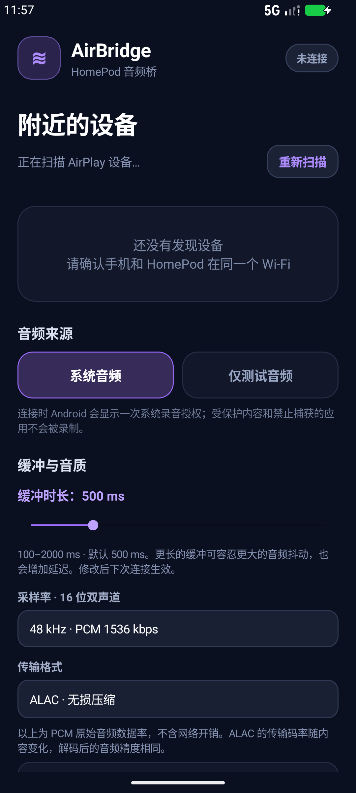

# AirBridge for Android

把安卓设备的声音发送到同一局域网的 HomePod。界面、设备发现、音频捕获和 AirPlay 引擎都在 APK 内运行，不需要电脑或单独启动后端。

[下载最新版 APK](https://github.com/Godoshi9/AirBridge-Android/releases/latest) · [Windows 项目](https://github.com/Godoshi9/AirBridge-Windows) · [English](README.en.md)



## 安装与使用

1. 从发布页下载 `AirBridge-Android-1.1.0.apk`，在安卓设备上安装。
2. 手机与 HomePod 连接同一局域网，打开 AirBridge 并扫描设备。
3. 选择音频来源、缓冲时长和格式，再选择设备、连接并按系统提示授权。
4. 使用测试音频确认 HomePod 发声，再播放应用内容。

发布 APK 使用原有 AirBridge 发布证书，可覆盖安装 1.0.0。它包含 `arm64-v8a`、`armeabi-v7a` 和 `x86_64` 原生引擎。文件校验值见发布页的 `SHA256SUMS.txt`。

## 功能

- 局域网 HomePod 发现及已有立体声组识别。
- Android 10+ 系统播放捕获；Android 9 可使用麦克风或测试音频。
- HomePod 音量、测试音频、前台服务及通知控制。
- **100–2000 ms 缓冲**：步进 50 ms，默认 500 ms，自动保存，下次连接生效。
- **44.1 / 48 kHz、16 位双声道**，自动 / PCM / ALAC 选择。
- 显示实际协商格式、本机队列时长、欠载和溢出次数。
- 不包含 Windows 版的有线音响延后同步功能。

缓冲使用真实的有界预填充队列，欠载后重新积累并短暂淡入淡出。调高缓冲能容忍更大的抖动，也会增加延迟。缓冲设置不是实测端到端延迟，也不保证消除所有设备上的破音。

PCM 原始音频数据率分别为 **1411.2 / 1536 kbps**，不含网络开销。ALAC 是无损压缩，传输码率随内容变化，解码精度相同。本版本不支持 24 位或 96/192 kHz。

## 兼容性与验证范围

最低安装版本是 **Android 9 / API 28**。系统播放捕获从 Android 10 开始可用，受保护内容和主动禁止捕获的应用不会被录制。

1.1.0 已通过 Rust 25 项测试、Android Lint，以及 Android 16/API 36 模拟器上的发布包安装、冷启动、设置持久化和 JNI 缓冲验证。尚未完成实体安卓手机与 HomePod 的试听测试，也未验证 Android 17。

## 构建说明

需要 JDK 17、Android SDK Platform 34、Android NDK `30.0.16248370`、Rust 及 `cargo-ndk`。SDK 路径可通过 `ANDROID_HOME` 指定。

```powershell
cargo install cargo-ndk
rustup target add aarch64-linux-android armv7-linux-androideabi x86_64-linux-android
./build-android.ps1
```

脚本构建三个 ABI 的原生库，再使用附带的 Gradle Wrapper 构建 APK。开发构建位于 `app/build/outputs/apk/release/`，使用本机开发签名；发布页 APK 另用 AirBridge 原发布证书签名。私钥不在仓库内，开发签名 APK 不能覆盖安装正式发布包。

原生测试可在 `native/airbridge-engine` 运行 `cargo test --locked`；Windows 主机需要 MSVC 工具链。

## 许可证

本项目以 **GPL-3.0-or-later** 分发。原生引擎改编自 [Ding-Kyoma/AirFlash](https://github.com/Ding-Kyoma/AirFlash)，源码位于 `native/airbridge-engine`。详见 [LICENSE](LICENSE)、[THIRD_PARTY.md](THIRD_PARTY.md)。

---

## English technical reference: 1.1.0

AirBridge Android is a fully local HomePod audio sender. The Android UI, foreground capture service, device discovery and native AirPlay engine all run inside the APK. It does not require the Windows app or a separately started backend.

## Features

- Android 9 and newer (`minSdk 28`, no `maxSdk`) with guarded APIs for later Android versions.
- Native DNS-SD discovery of `_airplay._tcp` receivers.
- HomePod stereo grouping through `tsid`, `gpn` and `igl` metadata.
- One shared RTP timeline and PTP clock for an existing HomePod stereo pair.
- Android 10+ playback capture through MediaProjection.
- Android 9 microphone fallback and an always-available local test tone.
- HomePod volume control, notification controls and background foreground-service playback.
- User-selectable 100–2000 ms audio buffering (50 ms steps, default 500 ms), persisted locally and applied on the next connection.
- A frame-aligned bounded native queue that waits for prefill, refills after underruns, and fades transitions over 5 ms to reduce clicks. Overflow recovery is counted rather than silently dropping arbitrary incoming chunks.
- Selectable 44.1/48 kHz, stereo, 16-bit audio. PCM payload rates are 1411.2/1536 kbps; ALAC preserves the same decoded precision with a content-dependent compressed bitrate. No 24-bit or 96/192 kHz support is claimed.
- Automatic / PCM / ALAC codec selection and live negotiated-format, queue depth, underrun and overflow reporting.
- Single capture producer; test tones are mixed into the existing timeline instead of inserting additional PCM blocks. Test-only playback is paced by the selected sample rate and continues silence to flush its tail.

The buffer setting controls local prefill and the AirPlay latency request (`max(150, buffer_ms)`). These are separate stages, so the displayed buffer is **not** a measurement of end-to-end audible delay. HomePod may impose a different playback buffer. Increasing buffering also increases audible delay. This is audio jitter buffering, not the Windows wired-speaker delay-sync feature.

## Validation for 1.1.0

25 Rust tests pass, including prefill at both rates and 100/500/1000/2000 ms, jitter, underrun recovery, overflow bounds, stereo frame integrity and independent bit-exact ALAC decoding. Android lint reports no issues. Release-APK instrumentation on the Android 16 emulator verifies settings persistence, settings passed to the native engine, and JNI queue duration/validation. The APK installs over 1.0.0 using the same signing certificate.

This release has not undergone physical Android phone + HomePod listening tests or Android 17 device validation. These automated results do not guarantee elimination of crackling on every network or phone.

Some Android apps opt out of playback capture, and protected media cannot be captured. This is enforced by Android. The test tone can be used to verify the HomePod connection independently.

## Build

Requirements: JDK 17, Android SDK Platform 34, Android NDK r30, Rust and `cargo-ndk`.

```powershell
./build-android.ps1
```

The development-signed APK is generated under `app/build/outputs/apk/release/`. Distributed APKs in `../dist` are separately signed with the existing AirBridge release certificate; the private signing key is excluded from source archives.

## License

The AirPlay engine is derived from AirFlash and is distributed under GPL-3.0-or-later. The corresponding source, attribution and `LICENSE-GPLv3.txt` are included with this project and the accompanying source package.
